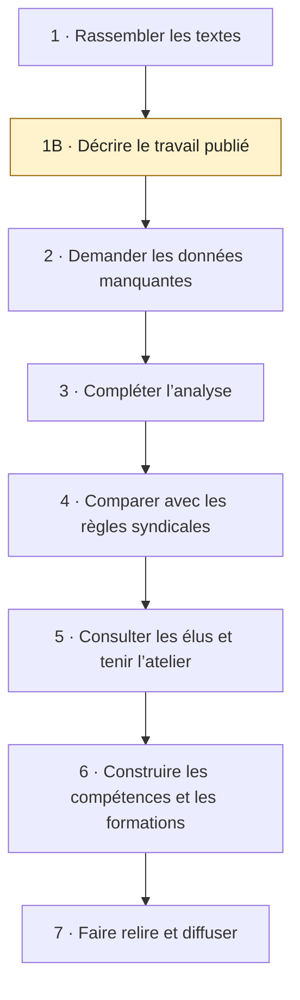

# Référentiel de compétences syndicales

**Avant de décider de la clôture de 1B :** consulter les [deux scénarios côte à côte, Codex et Gemini](rapports/comparaison-scenarios-phase-1b.md). Ce sont des propositions issues d’IA, à examiner par Steve.

### Comprendre le travail des élus pour mieux les soutenir

Un élu syndical écoute les membres, suit des dossiers, prépare des rencontres et travaille avec d’autres représentants. Mais que fait-il exactement? Avec quels moyens? Qu’est-ce qui rend son travail difficile?

Ce projet de recherche vise à réaliser une **analyse de situation de travail (AST) des élus syndicaux québécois**, à partir d’études scientifiques, de documents et de consultations avec les élus. Le but est de construire un **référentiel de compétences** : un guide qui relie les tâches aux connaissances et aux façons de faire nécessaires pour les accomplir.

Il s’agit d’une **recherche citoyenne indépendante en sciences de l’éducation**, centrée sur la formation des adultes. **Steve Prudhomme dirige le projet, conduit l’analyse et prend les décisions finales**, avec des consultations ponctuelles et sans comité de pilotage. Le projet cherche aussi à comprendre comment les élus apprennent leur mandat et ce qui les aide à progresser.

L’IA soutient la préparation documentaire; ses productions ne valent pas une relecture indépendante. Les 47 fiches actuelles sont des documents de travail préparés avec cette assistance; leur vérification personnelle par le responsable reste à consigner. [Comprendre les rôles et les responsabilités](docs/organisation-recherche.md).

**Point de départ proposé :** la vice-présidence au SSPHQ, section locale SCFP 4250. L’objectif est ensuite de proposer un outil adaptable aux autres fonctions des exécutifs syndicaux québécois.

[📍 Suivre les étapes](Roadmap.md) · [📖 Lire la pré-AST](rapports/pre-ast-documentaire.md) · [🔎 Explorer les sources](corpus/inventaire-sources.md) · [🤝 Contribuer](CONTRIBUTING.md)

## Où en sommes-nous?

**Au 26 octobre 2026 : la pré-AST documentaire est en cours — phase 1B.** Nous décrivons d’abord ce que les publications permettent de comprendre, avant de demander des données supplémentaires.

| Déjà disponible | Ce que cela représente |
|---|---|
| **19 documents retenus** | Consultés au moins en partie, parmi 24 entrées; 5 pistes restent séparées |
| **5 textes principaux dans la matrice** | Fortin-Bergeron et coll., Lonergan, Bernard Pelletier, Coderre-LaPalme et Bernard Pelletier–Le Capitaine |
| **47 constats documentaires** | 44 lignes d’activités et 3 conditions d’exercice, avec leurs sources et leurs pages |
| **14 familles provisoires** | Des regroupements pour comparer les activités; plusieurs constats peuvent concerner une même tâche |

Les lectures restent partielles. Les tâches ne sont pas encore validées avec les élus ni attribuées au poste de vice-présidence du SSPHQ. Les versions et amendements locaux restent à confirmer avant la comparaison détaillée avec les statuts.

➡️ [Voir les étapes cochées et les travaux restants](Roadmap.md) · [Consulter le journal des changements](CHANGELOG.md)

## Du travail réel aux compétences

Chaque phase prépare la suivante. Les [conditions de passage](Roadmap.md) précisent ce qui doit être prêt avant d’avancer.

## Ce que l’on cherche à comprendre

Pour chaque activité, nous posons cinq questions simples :

| Question | Ce que l’on note |
|---|---|
| **Qui fait le travail?** | La fonction et le contexte : présidence, vice-présidence, équipe ou autre acteur |
| **Que fait cette personne ou cette équipe?** | La tâche, formulée avec un verbe et un objet |
| **Comment s’y prend-elle?** | Les opérations réellement décrites |
| **Avec quels moyens?** | Le temps, les outils, les collaborations et l’autonomie |
| **Qu’est-ce que cela demande?** | Les exigences, les difficultés et les informations encore manquantes |

Par exemple, **informer les membres**, **recueillir leurs préoccupations** et **les consulter sur un mandat** sont liés, mais ne décrivent pas le même travail. Le [regroupement provisoire](pre-ast/consolidation-provisoire.md) conserve ces différences.

## Explorer les résultats actuels

| Pour… | Ouvrir… |
|---|---|
| Comprendre l’ensemble de la pré-AST | Le [rapport de travail en six chapitres](rapports/pre-ast-documentaire.md) |
| Voir les constats et retrouver les pages | La [matrice et les fiches d’extraction](pre-ast/matrice-taches.md) |
| Comparer les activités proches | Les [14 familles provisoires](pre-ast/consolidation-provisoire.md) |
| Voir ce qui reste à vérifier | Les [questions ouvertes](pre-ast/lacunes-documentaires.md) et le [suivi des lectures](pre-ast/suivi-depouillement.md) |
| Examiner le choix des documents | L’[inventaire](corpus/inventaire-sources.md), la [bibliographie](docs/bibliographie.md) et le [bilan de phase 1](rapports/bilan-phase-1.md) |

## Comment garder des résultats fiables?

Chaque constat garde sa source, sa page et ses limites. Nous distinguons les paroles publiées des participants, l’analyse des auteurs et nos propres regroupements. Une question dans un guide d’entretien ne prouve pas qu’une tâche a été accomplie.

Une activité de présidence ne devient pas automatiquement une activité de vice-présidence. Deux publications utilisant les mêmes entretiens ne comptent pas comme deux confirmations indépendantes. Les règles écrites et le travail décrit sont étudiés séparément avant leur comparaison.

Les élus pourront ensuite discuter, corriger et compléter cette première description. Le projet vise la **formation, le soutien et la reconnaissance des acquis**. Il ne crée pas de critères d’élection ou de destitution.

[Lire le protocole de recherche](docs/protocole-recherche.md) · [Comprendre la méthode](docs/methodologie.md) · [Consulter les mots utiles](docs/glossaire.md)

## Ce que le projet doit produire

- Une description documentée du travail et des questions encore ouvertes.
- Un rapport d’AST enrichi par la consultation des élus.
- Un référentiel reliant les compétences aux tâches validées.
- Un plan de formation et de soutien adapté aux fonctions.

La pré-AST actuelle est un **rapport de travail**. Le référentiel, l’AST terrain et le plan de formation restent à construire.

## Participer et réutiliser

Vous pouvez proposer une source, signaler une erreur de page ou expliquer une différence entre fonctions en suivant le [guide de contribution](CONTRIBUTING.md). Les [décisions du projet](docs/decisions.md) gardent la trace des choix et de leur statut.

Les documents de tiers et les données privées gardent leurs propres droits. La licence générale du dépôt reste [à choisir](LICENSE). Pour citer le projet, les informations sont dans [CITATION.cff](CITATION.cff).

Le [bilan préparatoire de 1B](rapports/bilan-preparatoire-phase-1b.md) et le [registre de contrôle du responsable](pre-ast/controle-responsable.md) séparent le travail documentaire assisté de la décision finale. Les cinq blocs ciblés sont traités; le contrôle personnel et la clôture de phase ne sont pas présumés.
